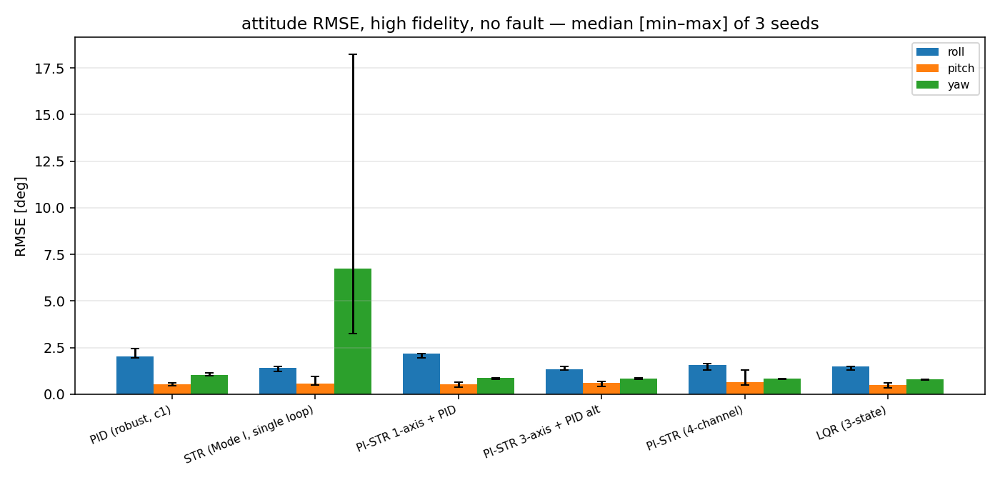
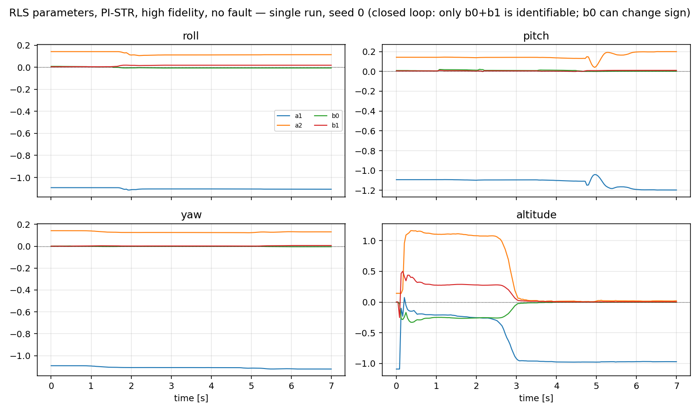
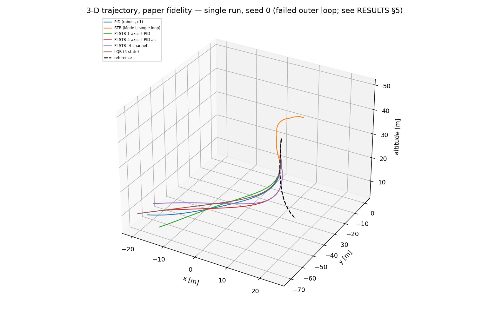
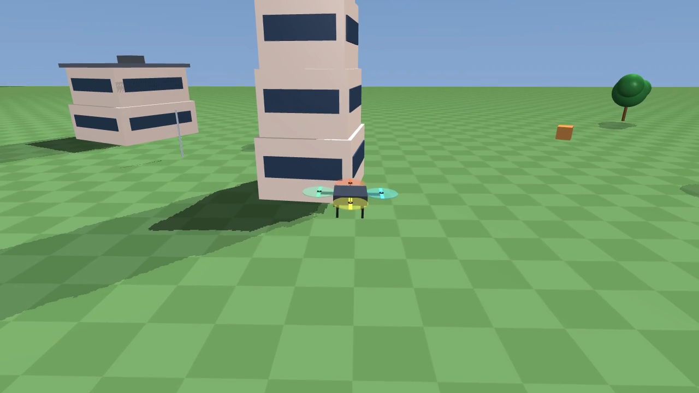

# PI-STR for Quadrotor

Firmware, a MATLAB study and a Python 3D simulator for a quadrotor tracking
controller that combines an **outer PI loop** with an **inner self-tuning regulator**
(recursive least squares identifies a discrete ARX model of the rate channel online,
pole placement retunes the inner loop from it). The control law comes from the paper
below; the flight code in `firmware/` is the implementation that flew on a DJI F450
airframe controlled by an Arduino Due.

**Reference**

> W. Lei, C. Li, M. Z. Q. Chen, *Robust Adaptive Tracking Control for Quadrotors by
> Combining PI and Self-Tuning Regulator*, IEEE Transactions on Control Systems
> Technology, vol. 27, no. 6, pp. 2663–2671, 2019.
> DOI: [10.1109/TCST.2018.2872462](https://doi.org/10.1109/TCST.2018.2872462)

Flying-test video from the paper: <https://youtu.be/u4nmebEKHow>

If you use this code, please cite the paper — machine-readable metadata is in
[`CITATION.cff`](CITATION.cff) and BibTeX is at the [bottom of this file](#bibtex).
Author affiliations are not recorded in this repository; take them from the paper.

---

## Status, honestly

| | |
|---|---|
| **No license** | There is no `LICENSE` file and the upstream repository never had one. This code is **not open source**; reuse and redistribution need written permission from the author. Read [`docs/licensing.md`](docs/licensing.md) before you copy anything. |
| **Simulation-only results** | The 2018 firmware did fly (see the paper and the video). The refactored code in this repository — the Python simulator, the host-tested C++ core, any new controller — has **not** been re-validated on hardware. |
| **Firmware is not host-compiled** | Only `firmware/lib/str_core/` is built and tested on a normal machine. The `.ino` sketches need an Arduino Due toolchain, which is not part of this repository's checks; no CI workflow is checked in at all. `platformio.ini` is provided but **unverified** (see its header). |
| **Refactor complete** | The reorganisation has landed: Python simulator + CLI + pytest suite, host-tested C++ core with two test entry points, the golden fixture, and the D-phase experiment matrix whose numbers are in [Results](#results) and [`docs/RESULTS.md`](docs/RESULTS.md). The `make` targets still name what is missing in a partial checkout. |

## Repository layout

```
.
├── firmware/                          Arduino Due flight code (2018, as published)
│   ├── Quadrotor_Mode_I_Arduino_Due/       single-loop STR, 3rd-order channel model
│   ├── Quadrotor_Mode_II_Arduino_Due/      PI outer loop + STR inner loop (2nd order)
│   ├── libraries/MyLibraries_Wenchao/      IMU/sensor drivers, attitude Kalman, legacy STR
│   ├── libraries/SdFat/                    vendored third-party SD library (GPL-3.0)
│   └── lib/str_core/                       host-testable STR core, C++17, no Arduino deps
├── sim/
│   ├── matlab/                        published study (MATLAB R2014a), kept as-is
│   │   ├── reduced_overshoot/              Mode I / Mode II attitude + altitude tracking
│   │   └── robustness/                     PID vs PI-STR over a 3-D trajectory
│   └── python/                        Python 3D simulator — the default entry point
│       ├── pistr_sim/                      params, types, plant, control, estimator, cli
│       │   └── env/                        optional MuJoCo 3-D world (see "3-D environment")
│       ├── tests/                          pytest suite
│       └── pyproject.toml
├── tests/
│   ├── cpp/                           C++ unit tests for firmware/lib/str_core
│   └── golden/                        cross-language conformance fixture (CSV)
├── results/                           experiment output: metrics.csv tracked, runs ignored
├── docs/                              specs and guides (see below)
│   └── figures/                       curated figures referenced by these docs (tracked)
├── CMakeLists.txt                     host build for the C++ core + tests
├── Makefile                           test-py / test-cpp / sim / clean (see `make help`)
└── platformio.ini                     two envs, one per sketch (unverified)
```

## Quick start

### Tested toolchain

Measured on the machine where this tree was assembled (macOS arm64). Treat it as one
data point, not as the minimum supported set — the code only asks for Python ≥ 3.10,
CMake ≥ 3.16 and a C++17 compiler.

| Tool | Version |
|---|---|
| Python | 3.12.12 |
| numpy / scipy | 2.4.4 / 1.17.0 |
| matplotlib | 3.10.8 |
| pytest | 9.0.2 |
| Apple clang (`clang++`) | 21.0.0 |
| cmake | 4.3.1 |
| GNU Make | 3.81 |

**Not available on that machine, and therefore untested here:** MATLAB (any version,
so the Control System Toolbox requirement is unverified), PlatformIO, and any
SAM/AVR Arduino toolchain. Everything that needs them is marked unverified below.

### 1. Run the Python simulation

```bash
PYTHONPATH=sim/python python3 -m pistr_sim.cli run \
  --scenario step --controller pi_str --plant physics --fidelity high \
  --out results/control_stack/physics_step
```

Or the same call from inside the package directory (`PYTHONPATH` is not needed there):

```bash
cd sim/python && python3 -m pistr_sim.cli run --scenario step --controller pi_str \
  --plant physics --fidelity high --out ../../results/control_stack/physics_step
```

`--out` is created if missing. A run writes `trace.csv`, `metrics.csv`,
`summary.json` and five PNGs there, and takes roughly 15 s for the default 30 s
scenario (17 s on the machine that wrote this file). `make sim` is a thin wrapper over
the same call: it forwards scenario/controller/fidelity/out and leaves `--plant` at its
default (`physics`).

**`--plant` picks the closed-loop engine, `--fidelity` picks the physics — two
different switches:**

| `--plant` | What runs | Use it for |
|---|---|---|
| `physics` (default) | `pistr_sim.plant`, the 6-DOF model at either fidelity | every control/robustness claim, closed-loop identification |
| `surrogate` | a plant-free ARX bench (same controller, ideal channel) | fast unit-level checks and paper-vs-code comparison — **not** evidence about the aircraft |

`--fidelity {paper,high}` only has meaning for `--plant physics`; with the surrogate
it is recorded and does nothing. Other entry points:

```bash
python3 -m pistr_sim.cli --list      # engines, scenarios, controllers, presets
python3 -m pistr_sim.cli run --help  # every knob
python3 -m pistr_sim.cli ident ...   # open-loop PRBS identification (CONTROL_SPEC §4)
```

Plant ablation: `--disable-extras inflow,h_force,body_drag,...`. Accelerometer tilt
correction: `--use-accel` (physics only, off by default).

Or drive it from Python directly:

```python
from pistr_sim import default_params
from pistr_sim.plant import QuadrotorPlant

plant = QuadrotorPlant(default_params("high"))    # "paper" for the parity model
state = plant.reset()                             # level, at rest
state = plant.step([1150, 1150, 1150, 1150])      # PWM in µs, one dt = 1 ms
sample = plant.sense()                            # noisy, one sample delayed
```

Controllers live in `pistr_sim.control` and `cli.py` is only the wiring. A controller
must consume `SensorSample`/`Estimate`, never `plant.state` — otherwise the simulator
stops being a fair test (`docs/PLANT_MODEL.md` §9).

### 2. Run the host tests

```bash
make test-py     # python3 -m pytest sim/python/tests
```

(`make test` chains both: this pytest suite, then the C++ assertions below.)

The C++ core is built once, then verified through one of two entry points that share
the same test library:

```bash
cmake -S . -B build && cmake --build build -j

# Recommended in CI / sandboxes that refuse to exec a freshly linked binary:
python3 -c "import ctypes; d=ctypes.CDLL('build/libstr_core_verify.dylib'); \
            print(d.str_core_run_tests(b'all'))"     # 0 == PASS, else failure count

# Alternative, when this machine can execute new binaries:
ctest --test-dir build --output-on-failure
```

`str_core_verify` exports a stable C entry point, so `dlopen` works even where
`execve` of a new binary is blocked. It links the same `str_core_testlib` as the ctest
executable, so **the assertions are identical**: about 159 000 checks with 0 failures
expected (the exact count shifts with the selected suite — `make SUITE=guards test-cpp`
is 72). If `ctest` prints `Subprocess killed`, stay on the ctypes route: that is what
`make test-cpp` runs, while `make test-cpp-ctest` is the ctest one and inherits the
limitation. The library name is platform-specific: `libstr_core_verify.dylib` on
macOS, `libstr_core_verify.so` on Linux, `str_core_verify.dll` on Windows.

(`pytest` picks up `sim/python/pyproject.toml`, so `import pistr_sim` resolves without
`PYTHONPATH` or an install.)

### 3. Build the firmware

> **Unverified configuration.** No PlatformIO or Atmel SAM toolchain was available
> when `platformio.ini` was written, so it has never been built here. See the comment
> block at the top of that file for the known risks (vendored `SdFat`, library
> discovery) before debugging the flight code.

```bash
python3 -m pip install --upgrade platformio
pio run -e due_mode_ii               # build Mode II (PI-STR cascade)
pio run -e due_mode_ii -t upload     # flash to a connected Arduino Due
pio device monitor -b 115200         # serial log
pio run -e due_mode_i                # build Mode I (single-loop STR)
```

**Safety:** remove the propellers and secure the airframe before the first spin-up.
`Config.h` carries the frame/algorithm switches and, in the original code, a `DEBUG`
mode that forces minimum PWM — read that header before powering the ESCs.

### 4. Run the legacy MATLAB study (optional)

```matlab
cd sim/matlab/robustness
Sim_Trajectory_Tracking_Control.m
```

Needs MATLAB with the **Control System Toolbox** (`tf`, `c2d`). Written for R2014a.
Scenario switches are constants at the top of the script (`controller_chosen` = 1 for
robust PID, 2 for PI-STR; `state_add_dist_aero`, `state_add_dist_wind`).
`sim/matlab/reduced_overshoot/Load_SystemParameters.m` is the source of every
physical constant used by the Python port.

## Results

**Simulation only.** No hardware-in-the-loop or flight test exists in this repository;
read these numbers as a model-relative comparison, not as a flight-qualification claim.

The tables are **generated** from `results/metrics.csv` (one row per run) by
`python -m pistr_sim.experiments.report`, so the prose cannot drift away from the
measurements: rerun the matrix and the report and every table refreshes. Full tables,
per-fault cells, timing and the failure write-up live in
[`docs/RESULTS.md`](docs/RESULTS.md).

```bash
PYTHONPATH=sim/python python3 -m pistr_sim.experiments.matrix --quick   # 36 runs,   1.7 min
PYTHONPATH=sim/python python3 -m pistr_sim.experiments.matrix --full    # 192 runs, 10.4 min
PYTHONPATH=sim/python python3 -m pistr_sim.experiments.report           # refresh docs/RESULTS.md
```

`--quick` is the default. Per-run output stays in `results/` (git-ignored; only the
top-level `metrics.csv` is tracked); the curated figures below are tracked in
`docs/figures/`.

### Inner loop: roll step, high fidelity, no fault (median of 3 seeds)

| controller | overshoot | attitude RMSE | altitude RMSE |
|---|---|---|---|
| PID (paper `c1` baseline) | 85.7 % | 1.34° | 0.22 m |
| STR (Mode I, single loop) | 30.5 % | 3.98° | **8.95 m** |
| PI-STR (4-channel) | **4.13 %** | 1.09° | 0.15 m |
| LQR (3-state baseline) | 0.81 % | 1.00° | 0.35 m |

The mixed configurations sit in between: PI-STR on one axis plus PID elsewhere gives
1.38° / 82.4 %, PI-STR on three axes plus PID altitude gives 0.99° / 2.73 %
([`docs/RESULTS.md`](docs/RESULTS.md) §2). Every controller keeps the **nominal**
tuning — faults change the plant only, so the matrix measures robustness, not
retuning.

* **PI-STR wins on the paper's own metric**: 4.13 % overshoot against the paper's robust
  PID at 85.7 %, on the same roll step. LQR is the closest baseline (0.81 %, 1.00° RMSE)
  but it is model-based, has no integral action and does no online identification.
* **Mode I is not a deployable altitude controller.** Its attitude channels are fine
  (3.98° RMSE) while altitude RMSE is 8.95 m: the single-loop 3rd-order STR on the
  altitude channel is a paper-reproduction artefact, not a design to reuse.
* **Nothing diverged**: 192 full-matrix runs, 0 divergent, 0 safe-mode events.
* **Faults are absorbed without retuning**: across `aero_density` (+20 % air density,
  hence rotor coefficients), `mass_change` (+0.25 kg), `voltage_decay` (−15 % pack
  voltage) and `wind_gust` (3 m/s + Dryden), the adaptive controllers stay at
  0.96–1.54° attitude RMSE.
* **The `b0` sign flip is expected, not an identifier failure**: in 12 of 15
  high-fidelity PI-STR step runs `b0 < 0`, while median `b0 + b1 = 0.0133` stays stable.
  A smooth closed-loop reference is not persistently exciting, so only the sum is
  identifiable — this is the empirical confirmation of
  [`CONTROL_SPEC.md` §9.10](docs/CONTROL_SPEC.md#9-known-deviations-and-honest-disclosures).
  Open-loop PRBS (`python3 -m pistr_sim.cli ident`) recovers all four parameters.
* **CPU is not the constraint**: the 4-channel PI-STR costs about 5 721 cycles per 40 ms
  tick, 0.17 % of the Due's 3.36e6-cycle budget (3-axis 0.14 %, Mode I 0.32 %). These are
  analytical counts, not measurements on hardware.



![Altitude RMSE per controller, median [min-max] of 3 seeds: the Mode I STR misses altitude by about 9 m while every other controller holds it to a few decimetres](docs/figures/altitude_rmse.png)



### The 3-D trajectory is a reported failure, not a ranking

`trajectory_3d.png` is kept because silently dropping a failed experiment would be
worse — but **do not read it as controller quality**. The outer position loop does not
track the paper's 60 m lateral / 42° yaw reference in this harness: within 12 s the
vehicles end up hundreds of metres away (position RMSE 39–254 m in `paper` fidelity,
51–79 m in `high`). Two causes were identified:

1. the plan's `pitch = asin(u_x / (-m g))` mapping has the **opposite sign** to this
   repository's plant convention (same class of defect as
   [`CONTROL_SPEC.md` §9.9](docs/CONTROL_SPEC.md#9-known-deviations-and-honest-disclosures));
2. with high-fidelity drag, the paper's position gains (`k1 = 0.04`, `k2 = 0.4`) are far
   too soft.

A redesigned outer loop is future work, not a claim made here.



Full tables: [`docs/RESULTS.md`](docs/RESULTS.md) · per-run data:
`results/metrics.csv` · matrix summary / timing / CPU budget:
`results/matrix_summary.json`, `results/matrix_timing.json`, `results/cpu_budget.csv`
(regenerated, git-ignored).

## Paper figures ↔ scripts

| Paper experiment | MATLAB source | Python side |
|---|---|---|
| Reduced-overshoot attitude + altitude tracking, Mode I vs Mode II | `sim/matlab/reduced_overshoot/AttitudeandAltitude_Tracking_Control_Mode_{I,II}.m`, with `Plot_AttitudeandAltitude_TrackingResults.m` and `Load_SystemParameters.m` | `pistr_sim.cli run --scenario step --controller {str,pi_str} --fidelity paper` — the same experiment, not a pixel-level reproduction |
| Robustness / adaptation: PID vs PI-STR on the 3-D trajectory | `sim/matlab/robustness/Sim_Trajectory_Tracking_Control.m`, with `Plot_CompareResults_PID_vs_PI_STR.m` | `experiments.matrix --full`, the `scenario = trajectory` rows — **currently fails to track, see above** |
| Parameter-estimation plot (`Â` convergence in PI-STR) | `Plot_EstimationResultsofA_in_PI_STR.m` | `python3 -m pistr_sim.cli ident`, and `docs/figures/parameter_convergence.png` |

The MATLAB scripts are the published study and are kept as-is. The Python side
re-implements the same experiments and does **not** claim to reproduce the paper's
figures pixel-for-pixel; [`CONTROL_SPEC.md` §9](docs/CONTROL_SPEC.md#9-known-deviations-and-honest-disclosures)
lists every known difference.

## The two flight modes

| | Mode I | Mode II |
|---|---|---|
| Directory | `firmware/Quadrotor_Mode_I_Arduino_Due/` | `firmware/Quadrotor_Mode_II_Arduino_Due/` |
| Structure | single-loop STR on the angle | PI outer loop on angle + STR inner loop on rate |
| Identified channel | 3rd order, 6 parameters | 2nd order, 4 parameters |
| Loop timing (`Config.h`) | `STR_period` 100 ms | `LOOP_period` 10 ms, `STR_period` 40 ms |
| RLS | λ = 0.98, P₀ = 100·I | λ = 0.99, P₀ = 5·I |

The paper's headline result is Mode II. Mode I is the comparison case: no outer loop,
the STR has to absorb the actuator lag itself.

## Hardware, wiring and configuration

Pins and limits come from `Config.h` (identical in both sketches); the airframe comes
from `sim/matlab/*/Load_SystemParameters.m`.

| Item | Value |
|---|---|
| Board | Arduino Due (Atmel SAM3X8E, ARM Cortex-M3, 84 MHz) |
| Airframe | DJI F450 frame, APC 1047 propellers, SunnySky A2212 KV980 motors, 3S LiPo |
| Mixer | `#define QuadP` (plus layout; the Python side mirrors it with `FRAME_QUADP` in `pistr_sim/types.py` and `Airframe.arm_positions`). `QuadX` is implemented too |
| Motor outputs | `motor0..3` → pins **6, 7, 8, 9**, ESC PWM 1000–2000 µs via the `Servo` library |
| RC inputs | `channel1..4` → pins **2, 3, 4, 5** = roll, pitch, **altitude/throttle**, yaw |
| RC pulse mapping | received 1016–2016 µs (`Pulse_MIN_Original`/`Pulse_MAX_Original`) → 1000–2000 µs |
| Stick ranges | roll ±50°, pitch ±50°, yaw ±90°; throttle passes through as 1000–2000 µs |
| SD card | `CSPin` = pin **10** (logging, vendored SdFat) |
| Status LED | `ledPin` = pin **13** |
| Serial | `BaudRate` = **115200** (matches `monitor_speed` in `platformio.ini`) |

The rotor numbering follows the ASCII diagram at the top of each main sketch — that
comment is the authority on which arm is which.

## Firmware behaviour and safety

[`firmware/SAFETY_NOTES.md`](firmware/SAFETY_NOTES.md) is the authoritative hazard
log: it separates what was fixed in stage A, what was fixed after the audit, and what
is *identified but deliberately not fixed* because each of those changes flight
behaviour. The three points below are the ones that bite a builder first; every one is
verifiable in the code in this tree right now.

### `DEBUG` looks armed but never spins the motors

Both `Config.h` files define `DEBUG`. At the end of `Controller_run()` (Mode II) and
`Controller()` (Mode I):

```c
#ifdef DEBUG
  for (int i = 0; i < 4; i++) PWM_out[i] = PWM_MIN;
#else
  for (int i = 0; i < 4; i++) PWM_out[i] = constrain(PWM_ref[i], PWM_MIN, PWM_MAX);
#endif
```

The arming state machine in `Motor_control()` is **not** guarded by `DEBUG`, so with
`DEBUG` on the vehicle still latches `ARM_flag = 1` and lights the armed LED while
every output stays at `PWM_MIN`. "Armed, dead motors" on a fresh build is this
switch, not a wiring fault. Commenting `DEBUG` out is what gives the motors
authority — do it with the propellers off.

The firmware refactor in progress splits this overloaded switch into explicit
`MOTOR_ENABLE` / `MOTOR_TEST` flags in `Config.h`. If your checkout already has them,
follow the header comment there; the paragraph above describes the code that is in
this tree today.

### Startup window

`Motor_control()` holds all four outputs at `PWM_MIN` while `loop_index < 350` (3.5 s
at the 10 ms loop) before the arming logic is evaluated at all. Inside roughly the
first 1–3 s of that window the attitude filter is also estimating its angle bias
(`loop_index` 100–300 in `Sensor_calibrate()` / `Angle_calibrate()`), so keep the
vehicle still and level after power-up.

### Arming and disarming

| Action | Condition (`PWM_MIN` = 1000, `PWM_MAX` = 2000) |
|---|---|
| arm | roll ≥ 1990 µs **and** pitch ≥ 1990 µs (both cyclic sticks at the top) |
| disarm | roll ≤ 1015 µs **and** pitch ≥ 1985 µs |

The throttle channel is not part of either condition: lowering the throttle does not
disarm. `ARM_flag` stays 1 and the motors sit at idle PWM — use the disarm gesture.

### Known hazards

1. **No receiver-loss failsafe.** `Driver_Receiver.ino` updates `pulse1..4` from pin
   interrupts and `Receiver_copy()` copies the latest value unconditionally; there is
   no `micros()` timeout anywhere. If the transmitter link drops, the firmware keeps
   applying the last command — armed, at whatever throttle was last received. This is
   a genuine safety gap, not a theoretical one: `SAFETY_NOTES.md` §3.1 records it as
   *not fixed* and sketches the fix (per-channel edge timestamp → disarm after
   ~500 ms) that still needs a bench test.
2. **The QuadP yaw column disagrees with MATLAB, and this code has not been flown.**
   The firmware mixer gives motors 0–3 `-Yaw, +Yaw, -Yaw, +Yaw`, while the yaw column
   of `u_mix` in `sim/matlab/*/Load_SystemParameters.m` is `+1, -1, +1, -1` for motors
   1–4. Only one of the two can be right for a given propeller set and rotation
   direction; the discrepancy has not been resolved or verified on hardware here
   (`SAFETY_NOTES.md` §3, also recorded as `CONTROL_SPEC.md` §9.8).
3. **Nothing in this repository exercises the flight code.** The `.ino` files are not
   host-compilable and `platformio.ini` has never been executed (see
   [§3 above](#3-build-the-firmware) and `docs/architecture.md` §6). Treat every
   firmware change as unflown.

## Two fidelity levels in the simulator

| Level | Flag | What it models | Use it for |
|---|---|---|---|
| Paper | `--fidelity paper` | verbatim MATLAB port: Euler at 1 ms, `U = Umax·sqrt(PWM%)`, `T = kT·ω²`, no battery/ESC/wind/sensors | reproducing the published figures |
| High (default) | `--fidelity high` | BEMT rotor inflow (with vortex-ring branch), H-force, body drag, rotor gyroscopic moments, ESC lag + PWM quantisation, battery OCV/SoC/sag, Dryden turbulence, sensor noise/bias with a one-sample delay, RK4 | every new evaluation |

Both implement the same `Plant` protocol (`docs/PLANT_MODEL.md` §9) and are seen by
the controller only through `sense()`. The controller identifies the same 2nd-order
ARX channel in both cases — the high-fidelity plant exists precisely to test whether
that identification survives a plant that does not satisfy the ARX assumption. Every
extra term can be switched off for ablation and for the P12 equivalence test.

## 3-D environment (MuJoCo, optional)

Everything above integrates in time only: the plant is physically detailed, but there is no
world — no ground contact, no scene, no camera, no pixels. `sim/python/pistr_sim/env/` adds a
rendered 3-D world around the **same controller stack**, so the PI-STR loop can be watched
flying instead of inferred from a plot. Contract: [`docs/3D_ENVIRONMENT.md`](docs/3D_ENVIRONMENT.md).

| Piece | What it is |
|---|---|
| Vehicle | MJCF generated from `pistr_sim.params` — mass, full inertia tensor, arm geometry, rotor radius and spin directions are imported, never retyped (F450, 0.985 kg) |
| Rotors | `RotorPack`: PWM µs → ESC lag → motor/impedance → `T = kT·ω²`, `Q = kQ·ω²`; wrench applied at the CoM, contact solved by MuJoCo |
| World | ground, buildings (landable roofs), trees, crates/barriers/poles, skybox, sun + fill lights, optional hill terrain and wind markers |
| Camera | chase (follows heading only, never rolls), orbit, fixed, top |
| Video | off-screen rendering (CGL on macOS, EGL on Linux) streamed into ffmpeg as H.264 — no display required |
| Multi-vehicle | `n_drones` independent free joints, one controller each |
| Contact | real: the vehicle falls, hits the ground, rests on its legs (`z ≈ 0.14 m`), and can land on a roof |



```bash
make env-setup                # unpack MuJoCo into build/mjsim (the only networked target)
make test-3d                  # environment gates V1–V8
make demo-3d                  # rendered segments -> results/env/flight_demo.mp4
```

A poster or a single segment:

```bash
PYTHONPATH=sim/python:build/mjsim python3 -m pistr_sim.env.cli world --out results/env
PYTHONPATH=sim/python:build/mjsim python3 -m pistr_sim.env.cli demo --segments hover drop --t-end 4
```

What it does **not** do: the world is a different rigid-body integrator and contact model from
`plant.py`, so it is a second opinion, not a bit-exact replay; MuJoCo contacts are soft, so
impact is qualitative; there is no GPS, optical flow or PX4 SITL; and the published inertia
tensor is not physically realisable, so the model zeroes the `Iyz` entry that the MATLAB source
sets equal to `Ixz` (see `docs/3D_ENVIRONMENT.md` §7). Simulation only — nothing here has flown.

## Documentation

| Document | What it is |
|---|---|
| [`docs/CONTROL_SPEC.md`](docs/CONTROL_SPEC.md) | **normative** control specification — RLS, projection, Diophantine, guards, saturation, known deviations |
| [`docs/PLANT_MODEL.md`](docs/PLANT_MODEL.md) | **normative** plant specification — BEMT, propulsion, battery, sensors, wind, validation suite P1–P12 |
| [`docs/quickstart.md`](docs/quickstart.md) | the usage paths, in detail, with troubleshooting |
| [`docs/3D_ENVIRONMENT.md`](docs/3D_ENVIRONMENT.md) | **normative** 3-D world specification — frame mapping, module contract, gates V1–V8, honest limits |
| [`docs/architecture.md`](docs/architecture.md) | module boundaries, firmware stack, how the C++ core relates to the sketches, current status |
| [`docs/RESULTS.md`](docs/RESULTS.md) | D-phase results — controllers × fidelity × faults, generated from `results/metrics.csv` |
| [`docs/licensing.md`](docs/licensing.md) | why this repository has no license, and what to do about it |
| [`tests/golden/README.md`](tests/golden/README.md) | cross-language conformance fixture format |
| [`CITATION.cff`](CITATION.cff) | citation metadata |

If two documents disagree: the specs win over `architecture.md`, which wins over this
README.

## Known limitations

1. **No hardware validation of the refactor.** Nothing in `sim/python/` or
   `firmware/lib/str_core/` has been flown. Treat every number it produces as a
   simulation result.
2. **The firmware does not compile on a normal host.** `.ino` files require the
   Arduino Due toolchain; they are reviewed by hand. Only `str_core` is unit-tested,
   and `platformio.ini` has never been executed. Receiver-loss and yaw-mixer hazards
   are listed under [Firmware behaviour and safety](#firmware-behaviour-and-safety).
3. **MATLAB needs the Control System Toolbox** and is untested on releases after
   R2014a. It is kept for reproduction, not for new work.
4. **The high-fidelity plant is a model, not flight data.** It is calibrated to
   physical coefficients and validated by an internal suite (P1–P12 in
   `docs/PLANT_MODEL.md`), not against logged flights. Blade flapping, rotor-rotor
   interference, motor thermal derating, ESC current limiting and structural
   flexibility are explicitly out of scope.
5. **15 documented deviations** between the paper, the MATLAB code, the firmware and
   this port. [`docs/CONTROL_SPEC.md` §9](docs/CONTROL_SPEC.md#9-known-deviations-and-honest-disclosures)
   is the authoritative list — it covers the legacy `s0`/`s1` index bug, the MATLAB
   Mode I history-index defect, the `STR_period / 1000` integer division that left the
   inner loop without reference feedforward, the never-assigned `y_desire[]`, the
   `km ≠ ke` energy inconsistency and the QuadP yaw-mixer sign. Read it before
   trusting either the published MATLAB results or the original firmware; it is also
   why `firmware/lib/str_core/` exists.
6. **Deliberate divergences are still divergences.** §9 items 11–12 are behaviour
   changes made on purpose, and the two outer PI implementations still differ by
   design (firmware `Kp/Ki/Kd` in the angle domain vs the simulator's rate-domain
   loop, §7). Do not unify them without amending the spec.
7. **No license.** See [`docs/licensing.md`](docs/licensing.md).

## License

**None granted.** The upstream repository has no `LICENSE` file, so this code is
copyright of its authors with all rights reserved; it is not open source. Do not add
a license, redistribute, or publish derived work without written permission. The full
status, the third-party (GPL-3.0 SdFat) complication, and the suggested path to
obtaining a license are in [`docs/licensing.md`](docs/licensing.md).

## Contact

Maintainer of the original project: **Wenchao Lei** — wcleithinking@gmail.com,
GitHub [@wcleithinking](https://github.com/wcleithinking).

## BibTeX

```bibtex
@article{lei2019pistr,
  author  = {Lei, Wenchao and Li, Chanying and Chen, Michael Z. Q.},
  title   = {Robust Adaptive Tracking Control for Quadrotors by Combining {PI}
             and Self-Tuning Regulator},
  journal = {IEEE Transactions on Control Systems Technology},
  year    = {2019},
  volume  = {27},
  number  = {6},
  pages   = {2663--2671},
  doi     = {10.1109/TCST.2018.2872462}
}
```
