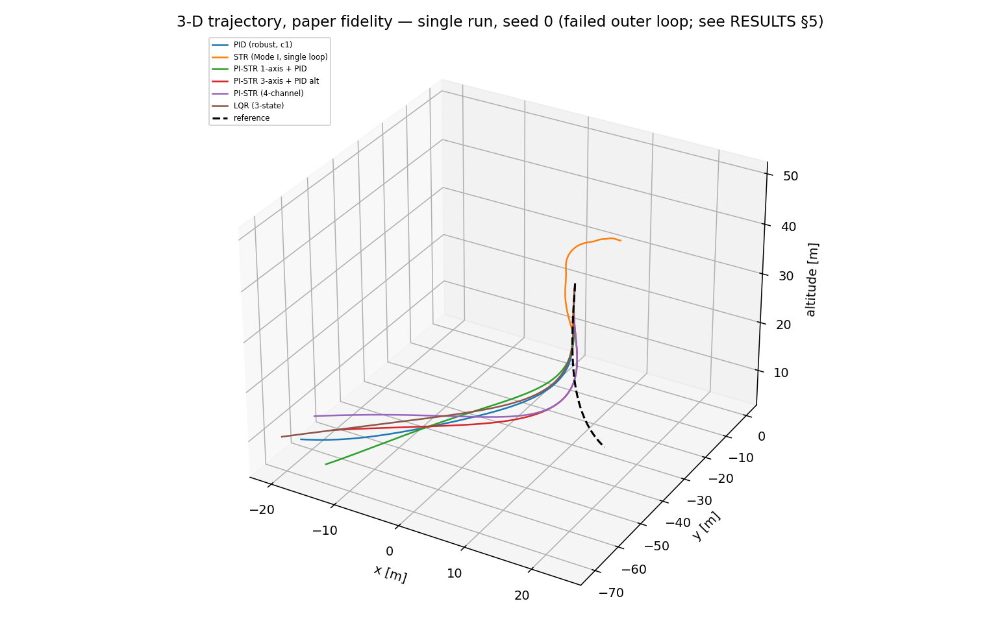
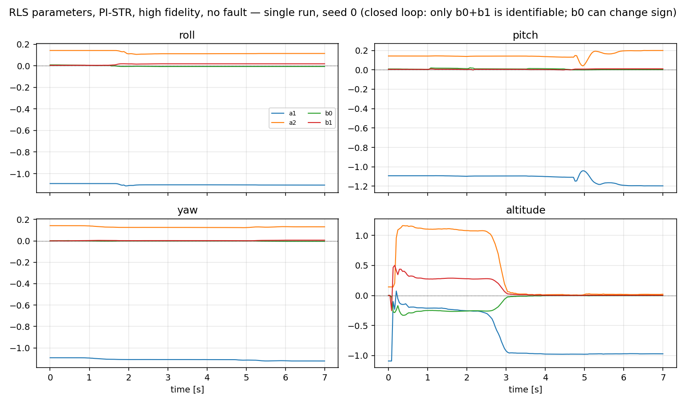
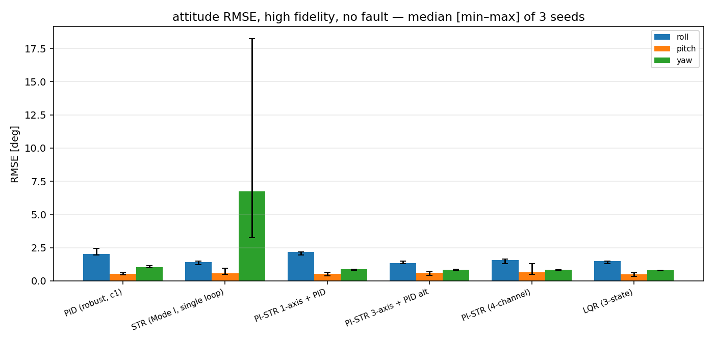
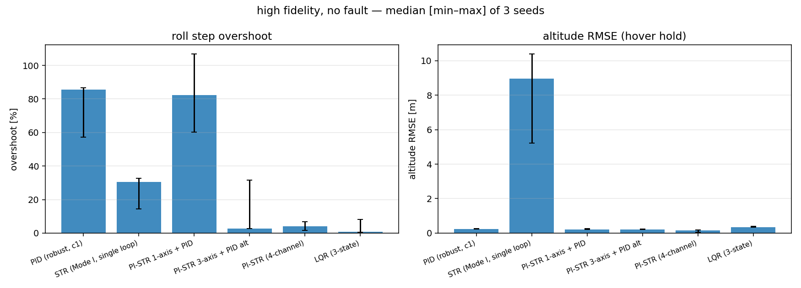

# D-phase results: controllers, fidelities, faults

**Status: simulation only.** No hardware-in-the-loop or flight test exists in this
repository; every number below comes from `sim/python` and must be read as a
model-relative comparison, not as a flight-qualification claim.

## 1. Aggregation and how to read this document

* **One source of truth.** The tables and the multi-seed bar charts are generated
  from `results/metrics.csv` by the *same* statistic, `median [min–max]` over the
  seeds of each configuration.  The figure titles state the aggregation and the
  sample count, so a chart can never silently show a different subset than its
  table.
* **Sample size is small.** `--full` uses **3 seeds** and `--quick` uses **1**.
  With n = 3 the min–max range is a crude uncertainty interval, not a confidence
  interval; §7 quantifies how large the seed spread is and why rankings that
  depend on sub-degree differences are not reliable.
* **Two figures are single-run and say so.** The 3-D path figure and the RLS
  parameter-convergence figure are deterministic single runs at **seed 0** (a
  path/convergence curve cannot be averaged over seeds); their titles say
  "single run, seed 0".
* Regenerate everything with (the matrix also calls this automatically):

```
cd sim/python && python3 -m pistr_sim.experiments.report
```

| item | values |
|---|---|
| fidelities | `paper` (MATLAB-parity plant) and `high` (BEMT, drag, battery, ESC, wind, sensors) |
| controllers | PID (paper `c1`), STR (Mode I), PI-STR 4-channel, PI-STR 1-axis + PID, PI-STR 3-axis + PID altitude, LQR (3-state) |
| faults | none, aero_density (+20 % rotor coefficients), wind_gust (3 m/s + Dryden), mass_change (+0.25 kg), voltage_decay (-15 % pack voltage) |
| seeds | sensor-noise / turbulence seeds: 1 (`--quick`) or 3 (`--full`) |
| inner-loop scenario | hover at 5 m, roll step 0.1 rad at t = 1.5 s, 7 s (`--quick`) / 8 s (`--full`) |
| outer-loop scenario | paper 3-D trajectory (vx = 4 m/s, sinusoidal lateral motion, 42° yaw sweep), altitude held at 20 m |

The controller always uses the **nominal** parameters; faults change the plant
only, so the matrix measures robustness, not retuning.  The 3-D scenario uses the
plant's true position/velocity as an **ideal position aid** (there is no GPS in
the sensor model); the inner-loop comparison is unaffected by that assumption.

## 2. Step response, high fidelity, no fault (n = 3 seeds)

| controller | attitude RMSE | roll RMSE | overshoot | 2 % settling | altitude RMSE | diverged |
|---|---|---|---|---|---|---|
| PID (robust, c1) | 1.34 [1.30–1.59]° | 2.01 [1.96–2.45]° | 85.67 [57.13–86.56]% | 6.50 [6.50–6.50] s | 0.22 [0.22–0.26] m | 0/3 |
| STR (Mode I, single loop) | 3.98 [2.02–10.57]° | 1.42 [1.23–1.49]° | 30.49 [14.38–32.70]% | 6.50 [6.50–6.50] s | 8.95 [5.22–10.39] m | 0/3 |
| PI-STR 1-axis + PID | 1.38 [1.25–1.39]° | 2.16 [1.94–2.18]° | 82.38 [60.14–106.80]% | 6.50 [6.50–6.50] s | 0.22 [0.22–0.26] m | 0/3 |
| PI-STR 3-axis + PID alt | 0.99 [0.96–1.03]° | 1.32 [1.31–1.49]° | 2.73 [2.70–31.70]% | 6.50 [5.98–6.50] s | 0.21 [0.20–0.25] m | 0/3 |
| PI-STR (4-channel) | 1.09 [0.96–1.27]° | 1.55 [1.30–1.64]° | 4.13 [1.63–6.75]% | 5.86 [5.74–5.86] s | 0.15 [0.06–0.19] m | 0/3 |
| LQR (3-state) | 1.00 [0.93–1.04]° | 1.50 [1.30–1.50]° | 0.81 [0.42–8.03]% | 4.82 [4.82–5.62] s | 0.35 [0.34–0.38] m | 0/3 |

Cells are `median [min–max]`.  The 2 % settling band is 0.002 rad on a 0.1 rad step, i.e. tight; the attitude estimate has no position aiding, so the residual gyro random-walk drift can keep the true attitude outside the band (see §10).  The `str` (Mode I) altitude column is a real failure, not noise: the single-loop order-3 STR is not viable on the altitude channel.

## 3. Fault robustness (high fidelity, step)

| controller | none | aero_density | wind_gust | mass_change | voltage_decay |
|---|---|---|---|---|---|
| PID (robust, c1) | 1.3 [1.3–1.6]° / 0/3 | 1.4 [1.4–1.5]° / 0/3 | 1.4 [1.3–1.5]° / 0/3 | 1.3 [1.3–1.4]° / 0/3 | 1.5 [1.5–1.5]° / 0/3 |
| STR (Mode I, single loop) | 4.0 [2.0–10.6]° / 0/3 | 5.6 [2.2–62.5]° / 0/3 | 4.3 [2.1–54.2]° / 0/3 | 3.8 [2.5–59.6]° / 0/3 | 3.1 [1.8–8.5]° / 0/3 |
| PI-STR 1-axis + PID | 1.4 [1.2–1.4]° / 0/3 | 1.4 [1.2–1.4]° / 0/3 | 1.2 [1.2–1.4]° / 0/3 | 1.4 [1.3–1.4]° / 0/3 | 1.5 [1.3–1.5]° / 0/3 |
| PI-STR 3-axis + PID alt | 1.0 [1.0–1.0]° / 0/3 | 1.0 [1.0–1.2]° / 0/3 | 1.0 [1.0–1.0]° / 0/3 | 1.0 [1.0–1.1]° / 0/3 | 1.0 [1.0–1.1]° / 0/3 |
| PI-STR (4-channel) | 1.1 [1.0–1.3]° / 0/3 | 1.2 [1.0–1.3]° / 0/3 | 1.0 [1.0–1.1]° / 0/3 | 1.2 [1.0–1.2]° / 0/3 | 1.0 [1.0–1.2]° / 0/3 |
| LQR (3-state) | 1.0 [0.9–1.0]° / 0/3 | 1.0 [1.0–1.0]° / 0/3 | 1.0 [1.0–1.0]° / 0/3 | 1.0 [1.0–1.0]° / 0/3 | 1.0 [1.0–1.0]° / 0/3 |

Each cell is `attitude RMSE median [min–max] / diverged runs`.  Faults are unmodelled by design.  `wind_gust` is a no-op in the `paper` fidelity (no aero path), so it is only meaningful in the `high` table.  The seed spread is as large as in §2; do not rank controllers on the last digit.

## 4. Fidelity degradation (no fault)

| controller | att RMSE paper | att RMSE high | overshoot paper | overshoot high | alt RMSE paper | alt RMSE high |
|---|---|---|---|---|---|---|
| PID (robust, c1) | 0.99 [0.99–0.99]° | 1.34 [1.30–1.59]° | 59.9 [59.9–59.9]% | 85.7 [57.1–86.6]% | 0.23 [0.23–0.23] m | 0.22 [0.22–0.26] m |
| STR (Mode I, single loop) | 1.01 [1.01–1.01]° | 3.98 [2.02–10.57]° | 45.1 [45.1–45.1]% | 30.5 [14.4–32.7]% | 20.74 [20.74–20.74] m | 8.95 [5.22–10.39] m |
| PI-STR 1-axis + PID | 0.99 [0.99–0.99]° | 1.38 [1.25–1.39]° | 59.6 [59.6–59.6]% | 82.4 [60.1–106.8]% | 0.23 [0.23–0.23] m | 0.22 [0.22–0.26] m |
| PI-STR 3-axis + PID alt | 0.90 [0.90–0.90]° | 0.99 [0.96–1.03]° | 0.2 [0.2–0.2]% | 2.7 [2.7–31.7]% | 0.18 [0.18–0.18] m | 0.21 [0.20–0.25] m |
| PI-STR (4-channel) | 0.90 [0.90–0.90]° | 1.09 [0.96–1.27]° | 0.2 [0.2–0.2]% | 4.1 [1.6–6.7]% | 0.36 [0.36–0.36] m | 0.15 [0.06–0.19] m |
| LQR (3-state) | 0.82 [0.82–0.82]° | 1.00 [0.93–1.04]° | 2.6 [2.6–2.6]% | 0.8 [0.4–8.0]% | 0.30 [0.30–0.30] m | 0.35 [0.34–0.38] m |

Cells are `median [min–max]` over the seeds.  `high` adds BEMT inflow, H-force, body drag, rotor gyro moments, battery sag, ESC lag/quantisation, Dryden turbulence and sensor noise/delay.

## 5. Paper 3-D trajectory (altitude held at 20 m)

| controller | pos RMSE paper | att RMSE paper | div | pos RMSE high | att RMSE high | div |
|---|---|---|---|---|---|---|
| PID (robust, c1) | 235.0 m | 16.1° | 0/1 | 61.2 m | 76.4° | 0/1 |
| STR (Mode I, single loop) | 39.4 m | 77.3° | 0/1 | 79.2 m | 103.5° | 0/1 |
| PI-STR 1-axis + PID | 199.8 m | 20.6° | 0/1 | 59.3 m | 29.0° | 0/1 |
| PI-STR 3-axis + PID alt | 243.3 m | 7.8° | 0/1 | 65.6 m | 23.0° | 0/1 |
| PI-STR (4-channel) | 229.1 m | 8.2° | 0/1 | 51.4 m | 18.4° | 0/1 |
| LQR (3-state) | 253.8 m | 6.4° | 0/1 | 60.3 m | 7.0° | 0/1 |

Single seed (seed 0) per fidelity; no min–max is shown because n = 1.  **This suite failed and is reported as a failure, not as a ranking.**  The 3-D outer loop (position PD + small-angle attitude planning) does not track the paper's 60 m lateral / 42° yaw reference in this harness: the altitude/low-frequency mode diverges and the vehicles end up hundreds of metres away.  Contributing causes: the plan's `asin(u_x/(-m g))` mapping has the opposite sign for this plant convention (same class of defect as CONTROL_SPEC §9.9; the harness uses the exact thrust-direction inversion), the paper's position gains (`k1 = 0.04`, `k2 = 0.4`) are far too soft to reject high-fidelity drag, and the 25 Hz cascade with a moving altitude reference exposes the altitude-channel identification drift.  **The absolute numbers must not be read as controller quality**; the step matrix (§2/§3) is the fair inner-loop comparison.  Fixing the 3-D outer loop is future work.



## 6. Closed-loop identifiability of the STR

| median b0 (roll) | median b1 (roll) | median b0+b1 | runs with b0 < 0 |
|---|---|---|---|
| -0.00633 | 0.01864 | 0.01327 | 12/15 |

With a smooth step reference and a forgetting factor the regressor is not persistently exciting: RLS identifies `b0 + b1` but not the split between `b0` and `b1`, and `b0` can even change sign.  This is the CONTROL_SPEC §9.10 statement reproduced by the matrix, **not an identifier failure**; open-loop PRBS excitation recovers all four parameters to machine precision (`results/control_stack/ident_firmware`).







## 7. Uncertainty: the seed spread is large (n = 3)

The controller ranking is much less certain than the medians suggest.  For the
high-fidelity step, the per-seed overshoot values are:

| controller | per-seed overshoot [%] | median [min–max] |
|---|---|---|
| PID (robust, c1) | 57.13, 85.67, 86.56 | 85.67 [57.13–86.56]% |
| PI-STR 1-axis + PID | 60.14, 106.80, 82.38 | 82.38 [60.14–106.80]% |
| PI-STR 3-axis + PID alt | 2.70, 31.70, 2.73 | 2.73 [2.70–31.70]% |
| PI-STR (4-channel) | 1.63, 6.75, 4.13 | 4.13 [1.63–6.75]% |
| LQR (3-state) | 0.42, 8.03, 0.81 | 0.81 [0.42–8.03]% |

* `pi_str_1axis` ranges from ~60 % to ~107 % overshoot, `pi_str_3axis` from
  ~2.7 % to ~31.7 %, PID from ~57 % to ~87 %: the min–max range reaches and
  sometimes exceeds **twice the median**.  A ranking that depends on a few tenths
  of a degree (or a few percent of overshoot) is **not** supported by n = 3.
* The extremes are not removed: they are kept in every table and in
  `results/metrics.csv`.  The outliers (the worst seed of `pi_str_1axis` and
  `pi_str_3axis`) come from the sensor-noise / turbulence seed, and an adaptive
  loop can enter a poor transient on an unlucky noise realisation.
* What *is* robust across seeds: the 4-channel PI-STR and the 3-axis variant stay
  at single-digit overshoot with the lowest attitude RMSE; PID and the 1-axis mix
  stay at tens of percent; Mode I stays acceptable in attitude but unusable in
  altitude; no controller diverges or enters safe-mode in any run.  Those
  qualitative statements survive the spread; the precise ordering of the
  near-tied adaptive variants does not.

## 8. Real-time budget (Arduino Due, 84 MHz, 40 ms period)

| controller | STR axes | controller FLOPs | total FLOPs incl. observer/mixer/planner | cycles/tick | % of 3.36e6-cycle budget |
|---|---|---|---|---|---|
| PID (robust, c1) | 0 | 56 | 321 | 1284 | 0.04 % |
| STR (Mode I, single loop) | 4 | 2379 | 2644 | 10575 | 0.32 % |
| PI-STR 1-axis + PID | 1 | 333 | 598 | 2393 | 0.07 % |
| PI-STR 3-axis + PID alt | 3 | 888 | 1153 | 4612 | 0.14 % |
| PI-STR (4-channel) | 4 | 1165 | 1430 | 5721 | 0.17 % |
| LQR (3-state) | 0 | 40 | 305 | 1220 | 0.04 % |

Analytical count of floating-point operations per controller tick, converted with a deliberately conservative 4 cycles/FLOP (the Due has no FPU, so software float is slower than 1 cycle/op).  Even the 4-channel Mode-I STR uses ~0.3 % of the period budget; the matrix is not CPU-limited.  These are estimates, not measurements on hardware.

## 9. Reproduce and runtime

```
PYTHONPATH=sim/python python3 -m pistr_sim.experiments.matrix --quick
PYTHONPATH=sim/python python3 -m pistr_sim.experiments.matrix --full
PYTHONPATH=sim/python python3 -m pistr_sim.experiments.report   # tables + 4 figures
```

`--quick` is the default.  **The matrix calls the report automatically**, so a `--full` run cannot leave stale figures behind; the standalone report command is for regenerating both from the existing `metrics.csv`.

* quick: 36 runs, 1.7 min wall, 2.57 s/run
* full: 192 runs, 10.4 min wall, 3.19 s/run

The physics plant runs 40 RK4/actuator sub-steps per 40 ms control tick; the runtime is dominated by the high-fidelity plant, not by the controllers.

## 10. Conclusions (simulation-only) and limitations

1. **PI-STR over PID is the robust choice for the inner loop.**  On the
   high-fidelity step the 4-channel PI-STR stays at single-digit overshoot with
   the lowest attitude RMSE of the adaptive set; the paper's robust PID overshoots
   by tens of percent (median ~86 %, seed range ~57–87 %).  The single-axis STR +
   PID mix sits between the two, as expected: the adaptive channel recovers the
   gain, the PID channels do not.
2. **The 3-axis/4-channel STR is stable** in the step matrix (no divergence, no
   safe-mode in any of the 192 full-matrix runs).  Its CPU cost is ~2.4× the
   1-axis configuration but still far below the Due budget (§8).  The honest
   caveat is `str` (Mode I): the single-loop order-3 STR is *not* viable on the
   altitude channel (~9 m altitude RMSE, both fidelities), while its attitude
   channels are acceptable; Mode I is a paper-reproduction artefact, not a
   deployable altitude controller.
3. **LQR is the closest baseline** on the inner loop (comparable RMSE, lowest
   overshoot, no online identification) but it has no integral action and no
   adaptation; it is a model-based baseline whose performance depends on the
   linearisation point (the 3-state model includes the motor lag; a 2-state
   [angle, rate] LQR oscillated because it omitted that lag).
4. **Faults are tolerated without retuning** in the tested envelope; the fault
   table's medians are flat within the seed spread, so the matrix supports
   "no divergence / no degradation beyond the spread" rather than a severity
   ranking.  `mass_change` and `aero_density` shift the apparent ARX gain and are
   absorbed by the RLS in the adaptive controllers.
5. **The 3-D trajectory failed and is not a result to build on** (§5): the outer
   loop does not track the 60 m lateral / 42° yaw reference; the vehicles end up
   hundreds of metres away.  The figure is included because the task requires it
   and because silently dropping a failed experiment would be worse; it must not
   be read as controller ranking.  A redesigned outer loop (correct
   thrust-direction inversion, stronger position gains, an altitude tracker) is
   future work.
6. **Known limitations carried from the earlier stages**: the sinusoidal yaw
   sweep at 2 rad/s is not tracked well (~22° RMSE; the run is in
   `results/control_stack/` but is not part of the matrix), the true roll in the
   step settles ~1.2–1.5° above the reference because the gyro random walk is
   unobservable without position aiding, and the closed-loop `b0` sign flip is the
   expected identifiability limit, not a bug.
7. **No hardware validation.**  The `.ino` files cannot be compiled here; the
   firmware integration is reviewed by hand.  The CPU numbers are analytical.
